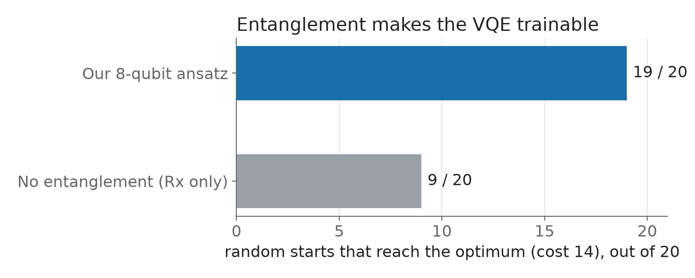
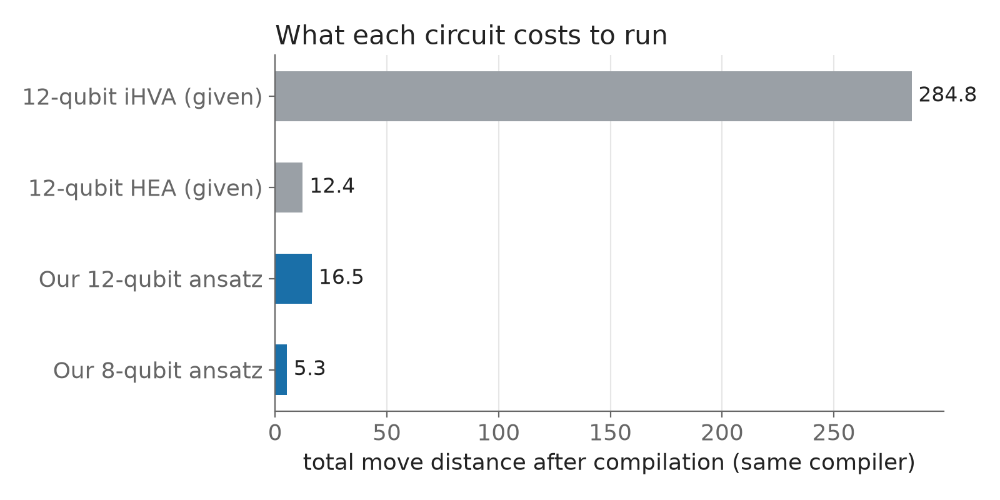
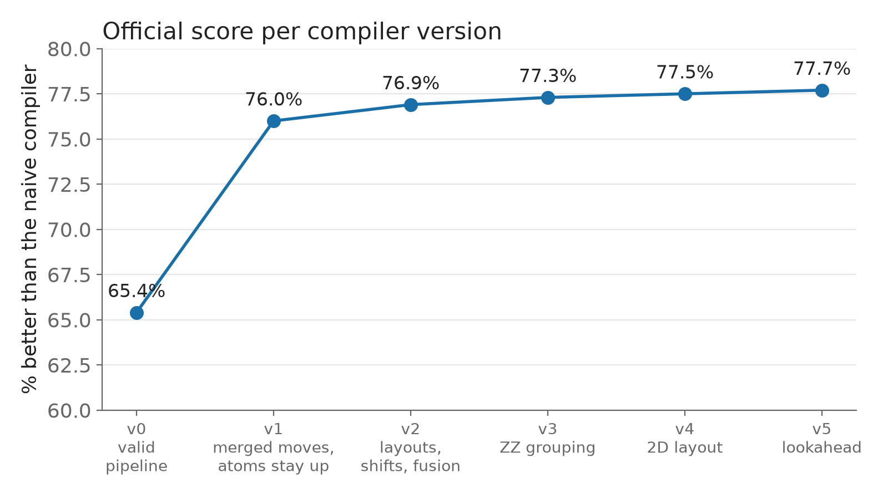
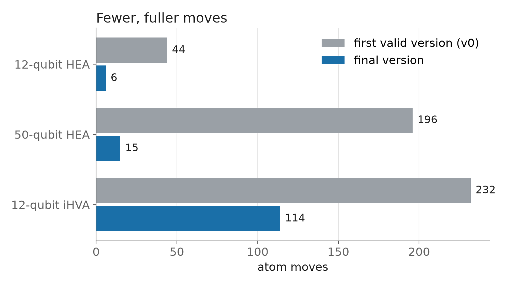

# Team Tucano — planqc × PushQuantum 2026

Two parts, one goal: solve the 12-bus-stop problem with a variational circuit, and run circuits like it on a zoned
neutral-atom machine with as little atom movement as possible.

| Part | What it delivers | Result |
|---|---|---|
| **Ansatz + VQE** | a hardware-native circuit that solves the bus-stop problem (`get_bus_stop_circuit`) | 8-qubit encoding; finds the optimum (cost 14) with probability 1 |
| **Compiler** | `compile_circuit(circuit, architecture_spec)`: native gates + legal atom moves | **77.7 %** better than the naive compiler on the official benchmarks, every circuit valid |

---

## Repository layout

```
submission/
├── README.md
├── pyproject.toml, uv.lock, .python-version   # uv project (Python 3.13, qiskit 2.6.2)
├── src/pushquantum/
│   ├── template.py              # compile_circuit: entry point called by the validator
│   ├── move.py, architecture.py, architectures/default.json   # organizers' template
│   └── compiler/                # our compiler (Part 2)
├── ansatz/                      # Part 1
│   ├── bus_stop_ansatz.py       # problem, encodings, Hamiltonians, ansatz builders, get_bus_stop_circuit
│   ├── bus_stop_vqe.py          # multi-start COBYLA VQE engine
│   ├── encoding_ablation_6q.py  # why 8 qubits: lower bound + 6-qubit comparison
│   ├── bus_stop_bonus_notebook.py   # marimo notebook with all results and plots
│   ├── ansatz_8q_p1_*.qasm, ansatz_12q_p1_*.qasm, ansatz_6q_p1_ablation.qasm   # exported circuits
│   └── qasm/                    # two public benchmark circuits used by the notebook
├── bench/                       # benchmark runner (uses the organizers' validator, not included)
├── figures/                     # result charts + the script that makes them
└── tests/
```

## Quick start

```bash
cd submission
uv sync

# Part 1: the optimized bus-stop circuit (run from ansatz/)
cd ansatz
uv run --project .. python -c "import bus_stop_ansatz as b; qc, meta = b.get_bus_stop_circuit('8q'); print(meta['kept_stops'], meta['optimal_probability'])"
uvx marimo edit --sandbox bus_stop_bonus_notebook.py
cd ..

# Part 2: compile any circuit
uv run python -c "from qiskit import QuantumCircuit; from pushquantum import compile_circuit; qc = QuantumCircuit.from_qasm_file('ansatz/ansatz_8q_p1_optimized.qasm'); compiled, arch = compile_circuit(qc, None); print(compiled.count_ops())"

# Benchmarks: put the organizers' `pushquantum_validator/` folder next to this README
# (or set PQ_VALIDATOR_DIR to the folder containing it), and the public dataset
# `pushquantum-2026-metric-hea-0.parquet` next to this README.
uv run python bench/run_bench.py            # table for the public benchmark circuits
uv run python bench/run_bench.py --score    # + the official score
```

---

## Part 1 — Encoding, ansatz and VQE

**Problem.** 12 stops, 18 neighbourhoods (four triangles + six bridges), costs c_i, penalty P = 5:
minimise F(x) = Σ c_i x_i + P Σ_(i,j) (1 − x_i)(1 − x_j). Unique optimum: keep {1, 2, 5, 6, 7, 8, 10, 12}, cost 14.

**8-qubit triangle encoding.** Every triangle must keep at least 2 of its 3 stops (otherwise the edge between the two
dropped stops is uncovered), so each triangle has exactly 4 valid states: 2 qubits.

| 2 qubits | meaning |
|---|---|
| `11` | keep all three stops |
| `10` | drop the 1st stop |
| `01` | drop the 2nd stop |
| `00` | drop the 3rd stop |

Bridges become penalties on pairs of triangle codes. Optimum: `00100001`.

**Why 8 and not fewer** (`encoding_ablation_6q.py`): the graph has 163 feasible covers, so an encoding that keeps all
of them needs at least ⌈log₂ 163⌉ = 8 qubits. A 6-qubit encoding is not cheaper to run (it compiles to the same 4 moves)
but it cannot represent every valid solution and turns the Hamiltonian into 6-body terms.

| Encoding | Qubits | CZ gates | Keeps every valid solution | Compiled moves / distance |
|---|---|---|---|---|
| 12 qubits | 12 | 10 | yes | 9 / 16.5 |
| **8 qubits** | **8** | **7** | **yes** | **4 / 5.3** |
| 6 qubits | 6 | 5 | no | 4 / 5.3 |

**Ansatz.** Native gates only (rx, rz, cz): rotation layers + 2 CZ rounds that fit the hardware (at most 5 pairs per
entangling row).

**VQE.** Multi-start COBYLA on the exact `SparsePauliOp` Hamiltonian. The optimum is a single bitstring, so the
question is not *whether* an ansatz can represent it but whether training finds it:





---

## Part 2 — Compiler

**Device rules.** Single-qubit gates only in storage, CZ only on pair sites in the entangling zone; atoms move with
AOD row/column moves; score = total move distance, then depth.

**What the score rewards** (found with small black-box experiments on the validator):
- One `move` costs only its longest atom trip, however many atoms it carries → *fewer, fuller moves*.
- During a CZ pulse every atom in the entangling zone must take part in a CZ.
- Distances are physical (pair sites are 0.3 apart, pairs 2.0 apart).

**Pipeline** (`src/pushquantum/compiler/`)

| Step | File | Idea |
|---|---|---|
| Preprocess | `preprocess.py` | native gates; commuting ZZ terms regrouped by **edge colouring**, so one pair of CZ pulses serves a whole colour; optional fan-out of a hub qubit onto extra atoms |
| Schedule | `schedule.py` | per-qubit queues → **diagonal blocks** of commuting CZs (no storage trip inside a block) → pulses; Rz pushed through CZs (2 gates per storage visit) |
| Place | `placement.py` | starting layouts: Cuthill–McKee snake or **2D layout by simulated annealing**; pair sites by shared column shift, interleaved rows (vertical pairs) or Hungarian matching with lookahead |
| Route | `routing.py` | atoms merged into the fewest legal rectangle moves (no ghosts, no crossing, one zone) |
| Emit | `emit.py` | final circuit; atoms stay up between consecutive pulses; park next to their next partner |
| Pick best | `__init__.py`, `cost.py` | ~150 variants per circuit, scored with an exact copy of the distance metric + depth; best one returned |

**Results** (official `score_compiler`: % better than the naive compiler; all benchmarks valid)





| Version | Main idea | Score |
|---|---|---|
| v0 | complete valid pipeline | 65.4 % |
| v1 | many atoms per move; atoms stay up between pulses | 76.0 % |
| v2 | snake layout, shared shifts, dynamic return, Rz fusion | 76.9 % |
| v3 | ZZ grouping by edge colour, depth-aware ranking | 77.3 % |
| v4 | 2D grid layout with interleaved rows | 77.5 % |
| v5 | lookahead placement | **77.7 %** |

Compile time: under 1 s for small circuits, ~52 s for the largest (50-qubit QAOA p3), limit 300 s.
